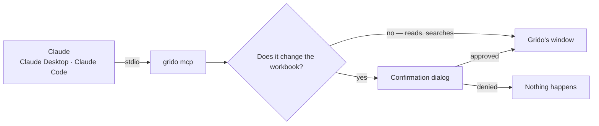

# Grido


Grido is a fast native spreadsheet for the `.xlsx` files you keep — trackers,
budgets, logs, contact lists — built on the [IronCalc](https://www.ironcalc.com)
engine, and a set of tools Claude can work in it with.

- Formulas, formatting, sorting, filters, names, conditional formatting,
  sheets and charts.
- **Tables by name.** Lists are read and written as records — `{column: value}`
  matched against the header row — rather than by row numbers.
- Undo grouped by action, autosave after Claude's edits, and a backup before
  its first write.
- `grido sales.xlsx` opens a workbook; a second launch hands the file to the
  window that is already open.

## The window

Drawn with [omarchy-kit](https://github.com/edimoldovan/omarchy-kit), in your
Omarchy theme's colours, the way Post is.

- **The bar along the top:** Grido's mark, then the tools a sheet is mostly
  worked with — undo and redo, cut, copy and paste, bold and italic, the
  alignment, the fill colour, the number format, sorting, the filter and find
  — and at the far end the palette's button and the gear.
- **The formula bar:** the name box, where typing a cell goes there, and the
  formula of the cell the keyboard is on.
- **The sheet,** then its tabs — each in the colour it was given, from the
  tab's right-click menu or the palette's *Tab colour…* — and the
  status line: the workbook and its sheet, what just happened, the selection's
  sum, average and count, and the zoom.
- **Settings,** from the gear or `Ctrl+,`: whether Claude may use Grido, and what it did.

## Every action, by name or by key

`Ctrl+K` — or `Ctrl+/`, `F1`, or the keyboard button beside the gear — opens the
palette: every action there is, found by typing, each with the key it is on,
then the sheets to go to and the workbooks opened last. `↑` `↓` walk it,
`Enter` runs one, `Esc` closes it.

Every binding can be changed: Grido reads `$GRIDO_KEYMAP`, `./keymap.toml` or
`~/.config/grido/keymap.toml`, over its built-in [`keymap.toml`](crates/grido/keymap.toml).

## Claude

When Grido first starts, it asks whether Claude may use it. Yes adds Grido to
Claude Desktop and Claude Code — whichever are installed — and installs the
**grido** skill, which teaches them how to use the tools below. The switch in
Settings changes the answer: off takes the entry and the skill out again.



Twenty `grido_` tools drive the window live — your edits and Claude's appear in
the same sheet: workbook info, open and save; table schema, append, find and
update by column name; range read, set and format; cells, rows, sheets, sort,
find, stats, templates, and undo.

- Changes to a workbook ask first, and can be allowed for good per tool.
- Reading and searching are free.

## Command line

| Command | |
|---|---|
| `grido` | Grido, with an empty workbook |
| `grido <file.xlsx>` | Grido, with that workbook |
| `grido mcp` | The MCP server Claude launches |

[`packaging/grido.desktop`](packaging/grido.desktop) puts Grido in the launcher
and offers it for `.xlsx` files.

## Where things live

| | |
|---|---|
| `~/.config/grido/` | Recent workbooks, the Claude choice, the tools allowed for good, and an optional `keymap.toml` |

## Building

```sh
cargo build --release
```

The binary is `target/release/grido`.

| Crate | |
|---|---|
| [`grido`](crates/grido) | The engine, the window and its tools |
| [`grido-app`](crates/grido-app) | The `grido` binary: its roles, the MCP server with its bridge onto the window, and the confirmation dialog |
